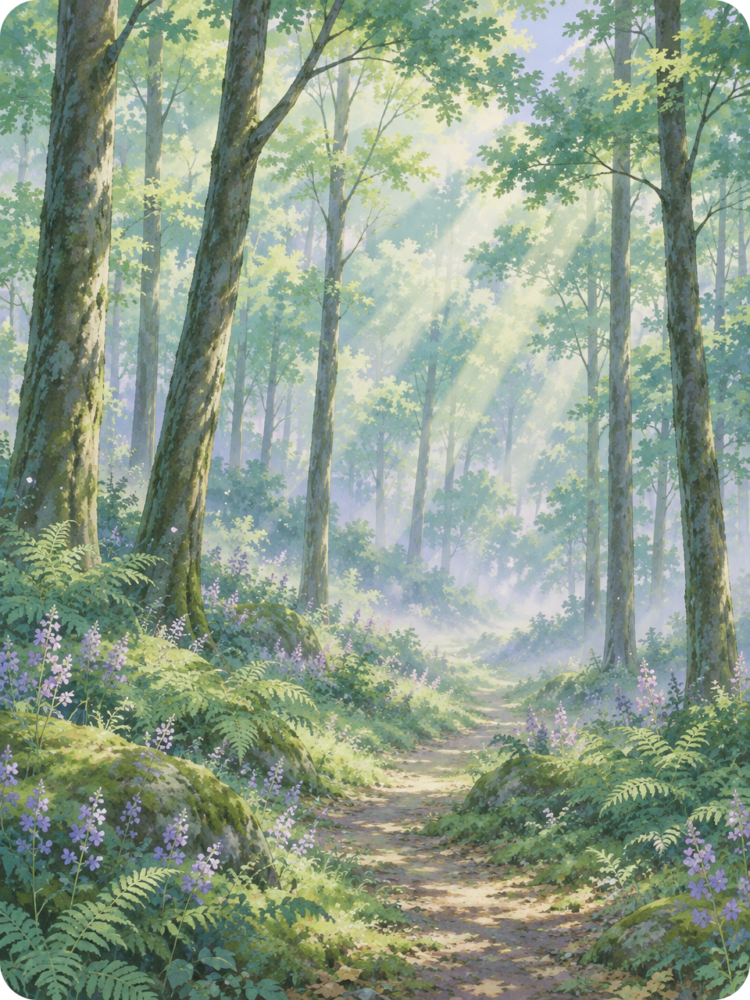
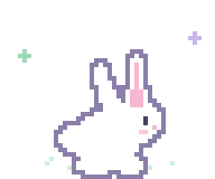
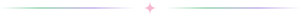

<!-- 🍂 Change with the season: spring.png, summer.png, autumn.png, winter.png -->

 
<i>I'm a passionate developer with a love for databases, backend development, and all that jazz, but I also have a guilty pleasure for design and UI/UX!</i>
  
<pre>
    💾 Fullstack dev • Guilty love of SQL • Data engineering
    🎨 Strong love for functional & pretty apps • UI/UX
    ☁️ DevSecOps & Cloud • Docker • Kubernetes • CI/CD
    📚 Constant learner • New technologies
    🎮 Video games • Cinema • Books • Cooking
    ✨ Dedicated to creating all sorts of cool stuff
</pre>
 

  

   
✦ things I love to play with ✦
  

 

 

 

 

 

 

 

 

  

🍃 enjoy the show ! 🍃

